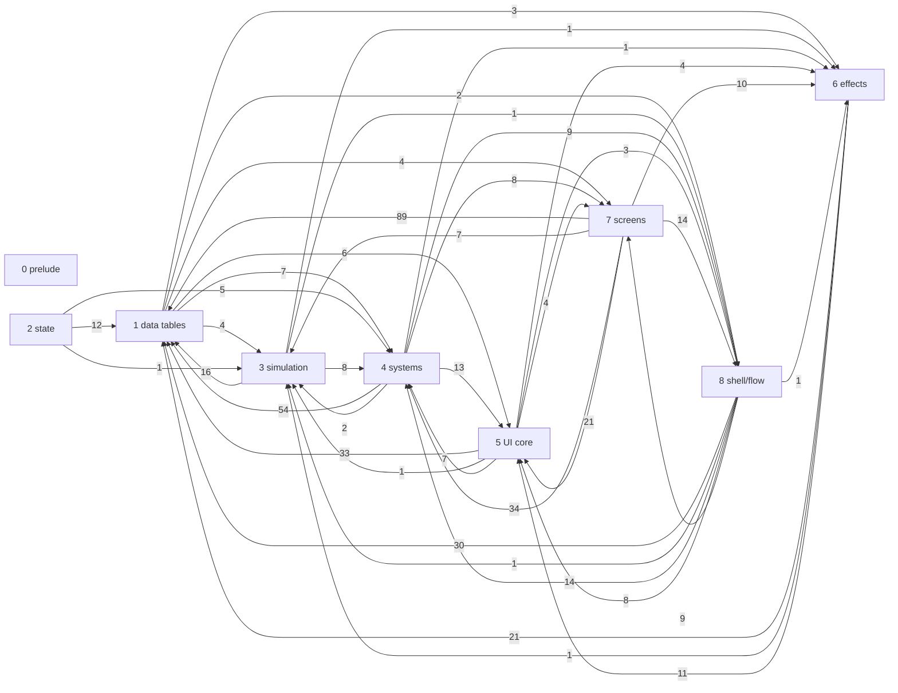

# Architecture — bản đồ phụ thuộc của game gốc

Sinh tự động bởi `tools/gen-arch.mjs` từ `src/js/` (96 file, 94 module export).

## Các tầng

| tầng | file | mô tả |
|---|---|---|
| 0 prelude | 1 | Mở IIFE, khai slot module, timers, proxy `t` |
| 1 data tables | 43 | Dex, move, story, scene, config… dữ liệu thuần |
| 2 state | 1 | Savegame: load/save/migrate, money, team, PC, XP, shop |
| 3 simulation | 2 | Idle engine: chọn zone, battle loop, catch, chapter |
| 4 systems | 13 | Cloud, raids, tower, underground, events, pension… |
| 5 UI core | 5 | Router screen, helper DOM, modal, bar, grid, card |
| 6 effects | 10 | FX canvas cho battle/capture/heal/badge/weather… |
| 7 screens | 15 | Từng screen UI |
| 8 shell/flow | 6 | Title, options, update, boot cuối cùng |

## Phụ thuộc giữa các tầng

| từ | tới | số cạnh |
|---|---|---|
| 1 data tables | 3 simulation | 4 |
| 1 data tables | 4 systems | 7 |
| 1 data tables | 5 UI core | 6 |
| 1 data tables | 6 effects | 3 |
| 1 data tables | 7 screens | 4 |
| 1 data tables | 8 shell/flow | 2 |
| 2 state | 1 data tables | 12 |
| 2 state | 3 simulation | 1 |
| 2 state | 4 systems | 5 |
| 3 simulation | 1 data tables | 16 |
| 3 simulation | 4 systems | 8 |
| 3 simulation | 6 effects | 1 |
| 3 simulation | 8 shell/flow | 1 |
| 4 systems | 1 data tables | 54 |
| 4 systems | 3 simulation | 2 |
| 4 systems | 5 UI core | 13 |
| 4 systems | 6 effects | 1 |
| 4 systems | 7 screens | 8 |
| 4 systems | 8 shell/flow | 9 |
| 5 UI core | 1 data tables | 33 |
| 5 UI core | 3 simulation | 1 |
| 5 UI core | 4 systems | 7 |
| 5 UI core | 6 effects | 4 |
| 5 UI core | 7 screens | 4 |
| 5 UI core | 8 shell/flow | 3 |
| 6 effects | 1 data tables | 21 |
| 6 effects | 3 simulation | 1 |
| 6 effects | 5 UI core | 11 |
| 7 screens | 1 data tables | 89 |
| 7 screens | 3 simulation | 7 |
| 7 screens | 4 systems | 34 |
| 7 screens | 5 UI core | 21 |
| 7 screens | 6 effects | 10 |
| 7 screens | 8 shell/flow | 14 |
| 8 shell/flow | 1 data tables | 30 |
| 8 shell/flow | 3 simulation | 1 |
| 8 shell/flow | 4 systems | 14 |
| 8 shell/flow | 5 UI core | 8 |
| 8 shell/flow | 6 effects | 1 |
| 8 shell/flow | 7 screens | 9 |

## File, module và phụ thuộc

| file | module export | tầng | size | phụ thuộc (module) |
|---|---|---|---|---|
| 000-prelude.js | — | 0 prelude | 10.5 KB | — |
| 001-tab-lock.js | TabLock | 1 data tables | 0.6 KB | — |
| 002-clock.js | Clock | 1 data tables | 2.3 KB | Game |
| 003-pokedex.js | POKEDEX | 1 data tables | 257.1 KB | — |
| 004-evolutions.js | EVOLUTIONS | 1 data tables | 6.2 KB | — |
| 005-moves.js | MOVES | 1 data tables | 35.8 KB | — |
| 006-item-names.js | — | 1 data tables | 0.9 KB | ITEM_NAMES |
| 007-encounters-kanto.js | ENCOUNTERS | 1 data tables | 14.0 KB | — |
| 008-base-exp-kanto.js | BASE_EXP | 1 data tables | 1.0 KB | — |
| 009-encounters-johto-headbutt.js | — | 1 data tables | 36.8 KB | ENCOUNTERS |
| 010-base-exp-johto.js | — | 1 data tables | 0.8 KB | BASE_EXP |
| 011-encounters-hoenn.js | — | 1 data tables | 18.5 KB | ENCOUNTERS |
| 012-base-exp-hoenn.js | — | 1 data tables | 1.0 KB | BASE_EXP |
| 013-encounters-sinnoh.js | — | 1 data tables | 41.4 KB | ENCOUNTERS |
| 014-base-exp-sinnoh.js | — | 1 data tables | 0.8 KB | BASE_EXP |
| 015-unown.js | UNOWN | 1 data tables | 0.6 KB | BASE_EXP, I18n, POKEDEX |
| 016-specials.js | SPECIALS | 1 data tables | 0.3 KB | BASE_EXP, POKEDEX |
| 017-forms.js | FORMS | 1 data tables | 4.0 KB | BASE_EXP, EVOLUTIONS, I18n, MOVES, POKEDEX, TYPES, WEATHER |
| 018-config.js | CONFIG | 1 data tables | 21.3 KB | CHANGELOG |
| 019-item-names-2.js | ITEM_NAMES | 1 data tables | 1.1 KB | CONFIG |
| 020-types.js | TYPES | 1 data tables | 0.6 KB | — |
| 021-type-chart.js | TYPE_CHART | 1 data tables | 1.2 KB | — |
| 022-i18n.js | I18n | 1 data tables | 2.0 KB | CONFIG, Game, ITEM_NAMES, MOVES, POKEDEX, TYPES |
| 023-i18n-t.js | _t | 1 data tables | 0.0 KB | I18n |
| 024-daytime.js | DAYTIME | 1 data tables | 2.0 KB | CONFIG, Clock, Game, SCENES, STORY |
| 025-weather.js | WEATHER | 1 data tables | 4.2 KB | Adventure, CONFIG, Clock, DAYTIME, Game, Roaming, STORY |
| 026-habitats.js | HABITATS | 1 data tables | 32.9 KB | — |
| 027-status.js | STATUS | 1 data tables | 3.2 KB | Game, MOVES |
| 028-story.js | STORY | 1 data tables | 87.4 KB | CONFIG, Clock, UNOWN |
| 029-scenes.js | SCENES | 1 data tables | 55.6 KB | Game, LegendZones, STORY |
| 030-game.js | — | 2 state | 44.3 KB | Adventure, CONFIG, CandyRun, Clock, Cloud, DAYTIME, EVOLUTIONS, FORMS, Game, LegendZones, MOVES, POKEDEX, Raids, STATUS … |
| 031-league-teams.js | LEAGUE_TEAMS | 1 data tables | 4.8 KB | — |
| 032-adventure.js | Adventure | 3 simulation | 73.7 KB | BASE_EXP, BadgeShine, CONFIG, CandyRun, Cloud, DAYTIME, ENCOUNTERS, EVOLUTIONS, Events, FORMS, Game, HABITATS, LEAGUE_TEAMS, LegendZones … |
| 033-underground.js | Underground | 1 data tables | 19.6 KB | Adventure, CONFIG, CandyRun, EVOLUTIONS, FORMS, Game, STORY, TYPES, WorldBoss |
| 034-events.js | Events | 4 systems | 11.6 KB | CONFIG, EVOLUTIONS, Game, News, POKEDEX, STORY, UI |
| 035-raid-swaps.js | — | 1 data tables | 0.1 KB | RAID_SWAPS |
| 036-raids.js | RAID_SWAPS Raids | 4 systems | 21.0 KB | Adventure, CONFIG, Cloud, EVOLUTIONS, EventUI, Frames, Game, News, POKEDEX, STORY, UI |
| 037-worldboss.js | WorldBoss | 4 systems | 7.3 KB | CONFIG, Cloud, Game |
| 038-tower.js | Tower | 4 systems | 11.8 KB | CONFIG, Cloud, EVOLUTIONS, Frames, Game, News, POKEDEX, STORY, UI |
| 039-candy-run.js | CandyRun | 4 systems | 6.6 KB | CONFIG, Cloud, EVOLUTIONS, Game, POKEDEX, Raids, STATUS, STORY |
| 040-legend-zones.js | LegendZones | 4 systems | 21.0 KB | CONFIG, Cloud, DAYTIME, Frames, Game, POKEDEX, STORY, TYPES, Tower, UI, Underground, WorldBoss |
| 041-roaming.js | Roaming | 4 systems | 2.0 KB | CONFIG, DAYTIME, Game, STORY |
| 042-sfx.js | Sfx | 1 data tables | 0.1 KB | — |
| 043-music.js | Music | 1 data tables | 0.1 KB | — |
| 044-sprite-bounds.js | SPRITE_BOUNDS | 1 data tables | 97.7 KB | — |
| 045-ui-core.js | Screens UI | 5 UI core | 79.4 KB | Adventure, App, CONFIG, Cloud, DAYTIME, EVOLUTIONS, FORMS, Frames, Game, I18n, ITEM_NAMES, LegendZones, LinkFx, MOVES … |
| 046-perf.js | Game Perf | 1 data tables | 1.4 KB | UI |
| 047-elite-frames.js | EliteFrames | 5 UI core | 57.8 KB | Game, LegendZones |
| 048-frames.js | Frames | 5 UI core | 33.4 KB | BadgeShine, CONFIG, CandyRun, Cloud, EliteFrames, Game, STORY, Tower, UNOWN, Underground |
| 049-badge-shine.js | BadgeShine | 6 effects | 11.0 KB | Frames, Game, STORY, Sfx, TrainerCard, UI |
| 050-battle-fx.js | BattleFX FX_MOVES | 6 effects | 175.4 KB | Game, MOVES, SPRITE_BOUNDS |
| 051-capture-fx.js | CaptureFX | 6 effects | 26.5 KB | Game, Sfx, ShinyGlint, UI |
| 052-item-fx.js | BerryFX ItemFX | 6 effects | 15.6 KB | CaptureFX, Sfx, UI |
| 053-link-fx.js | LinkFx | 6 effects | 41.4 KB | CaptureFX, Game, I18n, Sfx, UI |
| 054-raid-draw.js | RaidDraw | 6 effects | 9.7 KB | Game, TYPES, UI |
| 055-heal-fx.js | HealFX | 6 effects | 7.6 KB | CaptureFX, Sfx, UI |
| 056-shiny-glint.js | ShinyGlint | 3 simulation | 5.6 KB | Game |
| 057-gift-fx.js | GiftFx | 6 effects | 0.8 KB | Game, LinkFx, UI |
| 058-geode-fx.js | GeodeFx | 6 effects | 12.7 KB | Game, Sfx, TYPES, UI |
| 059-rank-fx.js | RankFx | 6 effects | 10.9 KB | Game, Sfx, UI |
| 060-weather-fx.js | WeatherFx | 1 data tables | 24.6 KB | Game |
| 061-vgrid.js | VGrid | 5 UI core | 5.8 KB | — |
| 062-event-ui.js | EventUI | 7 screens | 5.3 KB | Adventure, App, CONFIG, Events, Game, LegendZones, STORY, Screens, Screens.adventure, Sfx, TYPES, UI |
| 063-event-team.js | EventTeam | 7 screens | 15.9 KB | Adventure, App, CONFIG, Cloud, Events, Game, LegendZones, Raids, Sfx, UI, VGrid |
| 064-screen-adventure.js | Screens.adventure | 7 screens | 142.4 KB | Adventure, App, BattleFX, BerryFX, CONFIG, CandyRun, CaptureFX, CatchUp, Cloud, DAYTIME, EVOLUTIONS, EventTeam, EventUI, Events … |
| 065-screen-map-event.js | Screens.event Screens.map TravelFx | 7 screens | 53.4 KB | Adventure, App, CONFIG, Cloud, DAYTIME, EventTeam, EventUI, Events, Frames, Game, I18n, LegendZones, POKEDEX, Roaming … |
| 066-screen-raid.js | Screens.raid | 7 screens | 19.0 KB | Adventure, App, CONFIG, CandyRun, Cloud, EventTeam, Game, RaidDraw, Raids, SCENES, STORY, Screens, Screens.adventure, Screens.candy … |
| 067-worldboss-view.js | WorldBossView | 4 systems | 77.2 KB | App, CONFIG, Cloud, EventTeam, Game, I18n, LegendZones, POKEDEX, Screens, Screens.adventure, Screens.raid, Sfx, TYPES, UI … |
| 068-screen-tower.js | Screens.tower | 4 systems | 14.0 KB | Adventure, App, CONFIG, Cloud, Game, SCENES, Screens, Screens.adventure, Screens.candy, Screens.pension, Screens.raid, Sfx, Tower, UI |
| 069-screen-candy.js | Screens.candy | 7 screens | 12.5 KB | Adventure, App, CONFIG, CandyRun, Cloud, EventTeam, Game, Raids, SCENES, Screens, Screens.adventure, Screens.raid, TYPE_CHART, UI |
| 070-screen-underground.js | Screens.underground | 1 data tables | 51.8 KB | App, BattleFX, CONFIG, CaptureFX, EventTeam, Frames, Game, GeodeFx, I18n, SCENES, STORY, Screens, Sfx, TYPES … |
| 071-screen-achievements.js | Screens.achievements | 7 screens | 6.0 KB | Game, STORY, Screens, Screens.adventure, Sfx, TrainerCard, UI |
| 072-screen-team.js | Screens.team | 7 screens | 26.0 KB | App, CONFIG, EVOLUTIONS, FORMS, Game, I18n, STORY, Screens, Screens.pension, Sfx, TYPES, UI, Underground, VGrid |
| 073-screen-pension.js | Screens.pension | 7 screens | 27.3 KB | App, CONFIG, DAYTIME, FORMS, Game, LinkFx, PensionBerryFX, SCENES, SPRITE_BOUNDS, STORY, Screens, Screens.team, Sfx, UI … |
| 074-pension-berry-fx.js | PensionBerryFX | 4 systems | 5.7 KB | BerryBites, Game, UI |
| 075-berry-bites.js | BerryBites | 4 systems | 0.7 KB | — |
| 076-screen-pokedex.js | Screens.pokedex | 1 data tables | 24.5 KB | Adventure, CONFIG, DAYTIME, EVOLUTIONS, FORMS, Game, HABITATS, I18n, LegendZones, POKEDEX, Roaming, STORY, Screens, Screens.adventure … |
| 077-screen-shop.js | Screens.shop | 7 screens | 9.8 KB | App, CONFIG, Game, STORY, Screens, Screens.map, Sfx, UI |
| 078-screen-casino.js | Screens.casino | 7 screens | 65.5 KB | App, CONFIG, Game, GiftFx, I18n, LegendZones, Perf, SPRITE_BOUNDS, STORY, Screens, Screens.market, Sfx, UI |
| 079-screen-trade.js | Screens.trade | 7 screens | 42.4 KB | Adventure, App, CONFIG, CaptureFX, CatchUp, Cloud, Game, LinkFx, News, POKEDEX, SPRITE_BOUNDS, STORY, Screens, Sfx … |
| 080-screen-market.js | Screens.market | 7 screens | 39.1 KB | App, CONFIG, CatchUp, Cloud, Game, SPRITE_BOUNDS, STORY, Screens, Sfx, UI |
| 081-screen-friends.js | Screens.friends | 7 screens | 8.0 KB | Cloud, Game, STORY, Screens, Sfx, TrainerCard, UI |
| 082-trainer-card.js | TrainerCard | 5 UI core | 25.5 KB | App, BadgeShine, CONFIG, Cloud, Frames, Game, I18n, Names, POKEDEX, Perf, STORY, Screens, Screens.achievements, UI … |
| 083-names.js | Names | 1 data tables | 1.4 KB | — |
| 084-cloud.js | Cloud | 4 systems | 31.0 KB | CONFIG, CatchUp, Clock, Game, I18n, LegendZones, News, Raids, TabLock, Tower, UI, Update |
| 085-gifts.js | Gifts | 4 systems | 6.0 KB | App, CONFIG, Cloud, Game, GiftFx, I18n, Sfx, TrainerCard, UI |
| 086-screen-admin-loader.js | Screens.admin | 7 screens | 0.7 KB | Cloud, Screens |
| 087-options.js | Options | 8 shell/flow | 14.1 KB | App, BadgeShine, CONFIG, Changelog, Cloud, Game, Guide, I18n, Perf, TabLock, UI |
| 088-changelog.js | CHANGELOG | 1 data tables | 316.7 KB | — |
| 089-changelog.js | Changelog | 1 data tables | 1.7 KB | CHANGELOG, I18n, UI |
| 090-guide.js | Guide | 8 shell/flow | 19.4 KB | CONFIG, Raids, Tower, UI |
| 091-news.js | News | 8 shell/flow | 7.1 KB | Cloud, EventUI, Events, Game, I18n, STORY, UI |
| 092-title.js | Title | 8 shell/flow | 16.3 KB | Changelog, Cloud, Game, Names, POKEDEX, SPRITE_BOUNDS, STORY, Sfx, UI |
| 093-update.js | Update | 8 shell/flow | 2.5 KB | App, CatchUp, Cloud, Game, TabLock, UI |
| 094-sleep.js | Sleep | 1 data tables | 4.8 KB | Adventure, App, CatchUp, Game, I18n, Perf, STORY, Screens, TabLock, UI |
| 095-app-boot.js | App CatchUp | 8 shell/flow | 36.5 KB | Adventure, CONFIG, Changelog, Clock, Cloud, EventUI, Events, Game, Gifts, LegendZones, News, Options, POKEDEX, Raids … |

## Cụm phụ thuộc vòng (strongly connected components)

Vòng phụ thuộc ở bản phục hồi là bình thường: các screen và decorator gọi nhau qua namespace `t` lúc runtime, đây không phải import tĩnh. Có 1 cụm, lớn nhất 62 file.
- 002-clock.js, 015-unown.js, 017-forms.js, 022-i18n.js, 024-daytime.js, 025-weather.js, 027-status.js, 028-story.js, 029-scenes.js, 032-adventure.js, 033-underground.js, 034-events.js, 036-raids.js, 037-worldboss.js, 038-tower.js, 039-candy-run.js, 040-legend-zones.js, 041-roaming.js, 045-ui-core.js, 046-perf.js, 047-elite-frames.js, 048-frames.js, 049-badge-shine.js, 050-battle-fx.js, 051-capture-fx.js, 052-item-fx.js, 053-link-fx.js, 054-raid-draw.js, 055-heal-fx.js, 056-shiny-glint.js, 057-gift-fx.js, 058-geode-fx.js, 059-rank-fx.js, 062-event-ui.js, 063-event-team.js, 064-screen-adventure.js, 065-screen-map-event.js, 066-screen-raid.js, 067-worldboss-view.js, 068-screen-tower.js, 069-screen-candy.js, 070-screen-underground.js, 071-screen-achievements.js, 072-screen-team.js, 073-screen-pension.js, 074-pension-berry-fx.js, 076-screen-pokedex.js, 077-screen-shop.js, 078-screen-casino.js, 079-screen-trade.js, 080-screen-market.js, 081-screen-friends.js, 082-trainer-card.js, 084-cloud.js, 085-gifts.js, 087-options.js, 089-changelog.js, 090-guide.js, 091-news.js, 092-title.js, 093-update.js, 095-app-boot.js

## Điểm vào runtime

1. `boot.js` (sinh từ `src/boot/`) nạp language bundle, chèn markup `src/shell/app.html`, rồi nạp `vendor-supabase` + `bundle/app.js`.
2. `app.js` = prelude + 95 module nối tiếp; module cuối `095-app-boot.js` chạy `jt()` để khởi động.
3. `jt()`: init TabLock → load save → Cloud.init → `Title.show()` → Cloud/Clock ready → `Adventure.ensure()` → offline catch-up → render → gắn handler → `App` sẵn sàng.
4. Vòng lặp: `setInterval(5s)` tick sim; `requestAnimationFrame` cho FX; event `daytime`/`weather`/`visibilitychange` cập nhật.
